# Donor Role and Cross-Role Workflow Plan

> Implementation is now present in the Donor Portal, Donor Queue, `api/donor-portal.php`, and `api/donor-workflow.php`. Use the acceptance checks below for WAMP end-to-end verification.

## Purpose

Make the current Regular User role a useful Donor self-service account. Donors can manage their own contact information, request donation appointments, and review their own donation history. Blood bank employees remain responsible for collection records, screening, and inventory decisions.

This plan treats a donor account as a self-service identity. It does not make a donor's self-reported health information, eligibility estimate, or appointment request a clinical clearance or a completed donation.

## Role boundaries

| Role | Can do | Must not do |
| --- | --- | --- |
| Donor (`USER`) | Maintain own donor profile; submit, view, or cancel own appointment requests; view own donation dates and safe status updates | Browse other donors; create collection records or blood units; see screening results; access stock, allocation, hospital, audit, or analytics modules |
| Blood Bank Staff (`STAFF`) | Review donor profiles and appointment requests for their facility; contact donors; schedule or decline appointments; check in a donor; record an actual collection; create the quarantined unit through the existing donation workflow | Clear lab screening; view or change other facilities' records |
| Lab Technician (`LAB_TECHNICIAN`) | Review quarantined units; record required screening checklist; clear or reject a unit in their facility | Change donor identity/profile or mark a donation as collected |
| Administrator (`ADMIN`) | Approve requested Staff, Hospital Requester, and Lab roles; provision staff; manage accounts and facility settings; review audit events | Self-register as Admin or modify an audit record |
| Hospital Requester (`HOSPITAL_REQUESTER`) | Place and track their own hospital requisitions and transfusion slips | See donor identities or donor history |

## Donor lifecycle

```mermaid
flowchart LR
    A[Donor creates account] --> B[Donor completes profile and consent]
    B --> C[Profile awaits staff verification]
    C -->|verified| D[Donor requests an appointment]
    C -->|needs correction| B
    D --> E[Staff reviews and confirms, reschedules, or declines]
    E -->|confirmed| F[Donor checks in]
    F --> G[Staff records actual collection]
    G --> H[Unit enters quarantine]
    H --> I[Lab Technician records screening]
    I -->|passes| J[Unit becomes available to allocation]
    I -->|fails| K[Unit is rejected or discarded]
    J --> L[Staff allocates compatible stock to hospital request]
```

Declining an appointment or deferring a donor must not create an inventory unit. A donor's booking is never treated as a donation. The only path to stock is an actual collection entered by Staff, followed by Lab clearance.

## Donor-facing experience

1. **Account and profile:** Register as the Donor/Regular User role. Capture name and contact details, blood group, preferred donation facility, and consent to the stated use of data. Let the donor edit contact preferences and correct their own profile. Facility transfers require Staff review so past units and appointments are not silently moved between facilities.
2. **Profile verification:** Show a clear state such as `Needs verification`, `Verified`, or `Update requested`. Staff verifies identity and contact details before scheduling. Account sign-in can remain available while verification is pending, but donor actions that depend on verified identity remain disabled.
3. **Appointment request:** Let the donor choose an available date/time window and facility and submit a request. Show `Pending`, `Confirmed`, `Reschedule offered`, `Declined`, `Cancelled`, `Completed`, or `No-show`. Do not expose staff-only notes.
4. **Donation history:** Show only the donor's own collection dates and a limited safe status such as `Processing`, `Accepted`, or `Not used`. Do not expose detailed lab checklist responses or another person's information.
5. **Eligibility reminders:** If the project displays a cooldown or next eligible date, label it as an estimate based on recorded dates and configured policy. It must not state that the person is medically eligible. Staff confirms eligibility at collection according to the institution's procedure.
6. **Notifications:** Initially show status updates in the portal. Add email/SMS only after delivery configuration and consent are in place; never put sensitive screening detail in a notification.

## Data model changes

- Add a nullable, unique `users.user_id` reference on `donors` (for example, `donors.user_id`) so an authenticated Donor maps to at most one donor record. Keep `managed_by` for staff ownership/audit context; it is not the donor login link.
- Add donor profile verification state and timestamps, with the staff member who verified or requested corrections.
- Add a `donation_appointments` table with donor ID, facility ID, requested slot, scheduled slot, status, created/updated timestamps, and staff actor fields. Avoid storing unnecessary medical details in this workflow table.
- Keep actual donation and blood-unit creation in the existing `donors.php`/`inventory.php` staff workflow. Link each collection to the donor and appointment where applicable. Create the unit in quarantine only after staff records collection.
- Preserve historic donor records. Existing records must be linked to a login only after staff verifies the identity; do not auto-link solely because email or phone strings match.
- Apply institution IDs to every donor and appointment record so each Staff/Lab/Admin read and write is facility-scoped.

## API and authorization plan

- Add Donor-only endpoints such as `api/donor-portal.php?action=my_profile`, `my_appointments`, and `my_history`. Every read must derive the donor ID from the authenticated account's database link, never from a submitted donor ID.
- Allow Donors to edit only approved self-service fields. Reject role, facility, verification, blood-screening, collection, and unit-status changes from Donor requests.
- Add appointment create/cancel actions for a Donor's own linked record. Staff review actions must verify facility ownership and allowed status transitions on the server.
- Keep existing donor directory and donor CRUD endpoints Staff/Admin only. Do not broaden `api/donors.php` list access to Donors.
- Require Staff for donor verification, scheduling, check-in, and collection entry. Require Lab Technician/authorized Staff for screening according to the existing lab workflow. Admin approval remains required for Staff/Hospital/Lab role applications; Admin is never a selectable public role.
- Log profile verification, appointment decisions, check-in, collection, screening, clearance, rejection, and cancellation. Audit entries must not contain sensitive profile details or screening answers.

## Existing project pieces to reuse

- `USER` is the current Regular User role and can remain the internal role key; relabel it as `Donor` in the interface where appropriate.
- `donors.html` and `api/donors.php` already give Staff/Admin a donor directory and profile maintenance.
- `api/inventory.php` already supports staff donation entry and quarantine.
- `lab.html` and `api/lab.php` already support checklist-based clearance.
- Allocation already consumes cleared inventory and hospital requests; it should continue to receive no donor identity.
- The account approval queue handles Staff, Hospital Requester, and Lab role requests. Donor profile verification is a separate operational check, not a role promotion.

## Delivery phases

### Phase 1: Donor identity link

Add the donor-to-user link, facility ownership, profile verification states, and a safe process to link existing donor records. Keep current Staff donor screens working.

### Phase 2: Donor profile and history

Build a Donor portal for own-profile maintenance and read-only donation history. Add server-side ownership checks before exposing it in navigation.

### Phase 3: Appointment requests

Add appointment storage, Donor request/cancel screens, and a Staff review queue with audited state transitions.

### Phase 4: Collection and lab handoff

Connect a completed appointment to the existing Staff collection workflow, then to Lab quarantine and clearance. Show donors only a safe summary after the responsible staff action.

### Phase 5: Reminders and handoff

Add portal notifications and an Admin-configurable reminder window if needed. Document account linking, role boundaries, backup/migration, and test accounts.

## Acceptance checks

- A Donor can read/update only their own linked profile, appointments, and history, including when they alter IDs in requests.
- Donors cannot access donor directory, inventory, lab, allocation, hospital requisitions, analytics, simulation, or audit APIs.
- A Donor appointment request never creates inventory. Only Staff collection does, and the unit remains quarantined until Lab clearance.
- Staff and Lab accounts see only records in their facility; cross-facility appointment/profile actions fail closed.
- A donor can see a safe history summary but cannot retrieve detailed screening answers or another donor's history.
- Every sensitive state change is audited, and a failed audit insert rolls back the associated write.
- Existing donor rows remain intact; staff must verify before linking them to a new login.
- Existing account approval rules remain: Regular User/Donor registration is available, while Staff, Hospital Requester, and Lab access requires Admin approval; Admin can only be granted by an existing Admin promoting an approved Regular User.
